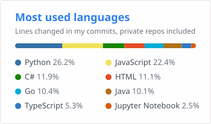

## Hi, I'm Ariel

Software Engineer at [EMERES](https://www.emeres.com), working on **Cirrus**, a computer-aided dispatch (CAD) platform for law enforcement, fire and EMS agencies. Most of my work is on the backend and platform side:

- **Identity and access:** single sign-on with Keycloak (OIDC, SAML / Entra ID, LDAP / Active Directory) and MFA for dispatchers and responders
- **Audit logging:** an event pipeline from NATS JetStream into ClickHouse, designed with FBI CJIS requirements in mind
- **Unit tracking:** GPS/AVL ingestion, live unit positions and incident playback maps
- **Platform:** GraphQL services and React micro-frontends, run in Docker and traced with OpenTelemetry

### Tech I work with

**Languages:**

**Frameworks and APIs:**

**Data and messaging:**

**Identity and security:**

**Platform and DevOps:**

**Observability:**

**Testing:**

### Stats

  <picture>
    <source media="(prefers-color-scheme: dark)" srcset="profile/stats-dark.svg">
    
  </picture>
  <picture>
    <source media="(prefers-color-scheme: dark)" srcset="profile/languages-dark.svg">
    
  </picture>

